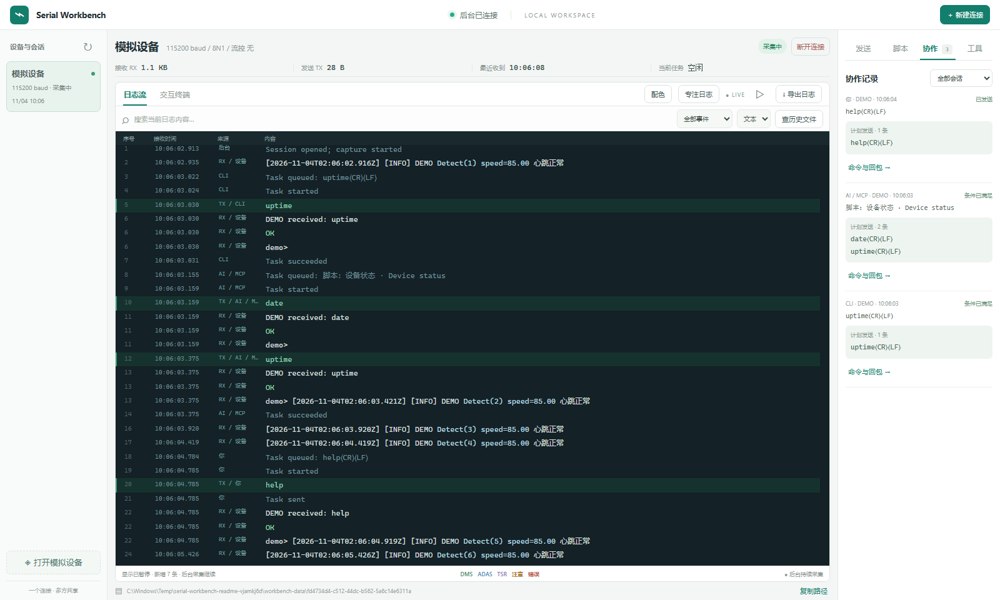
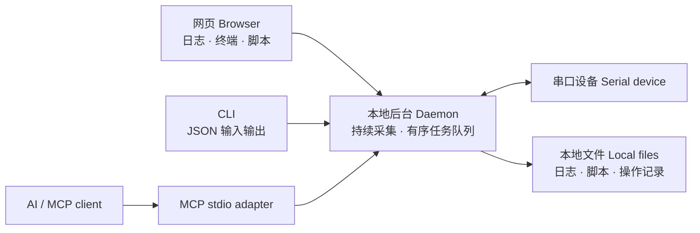
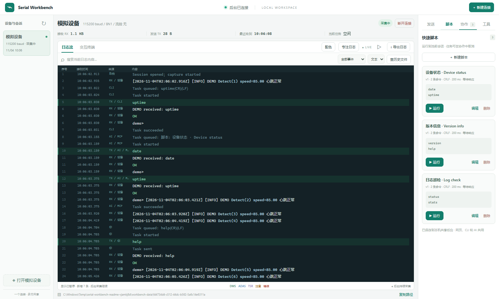
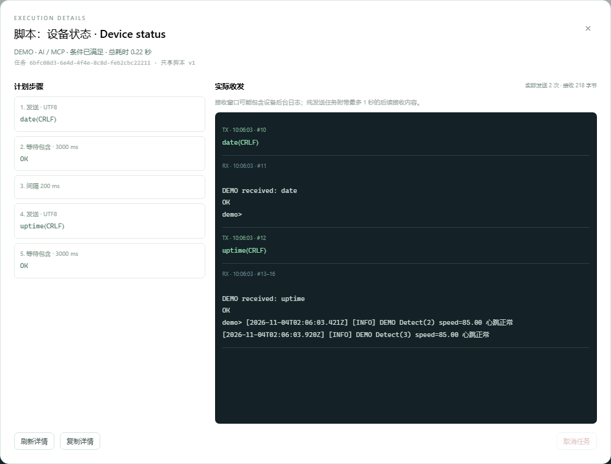

# Serial Workbench · 共享串口工作台

**一个串口连接，你和 AI 一起用。**<br>
**One serial connection. Shared by you and your AI tools.**

Serial Workbench 是面向嵌入式开发、设备联调和长时间日志观察的本地串口调试工作台。独立后台持有物理串口，网页、CLI 和 MCP 共用同一个会话、同一份日志与有序命令队列：你在浏览器里看设备输出，AI 同时查询日志、发送命令或运行脚本，每次操作的来源、具体命令和回包都能查看。

不用反复把串口从终端交给 AI，也不用在多个窗口之间复制日志。关闭网页或退出 AI 客户端后，后台仍继续采集；需要自己操作时，可以人工接管，再按需恢复共享。

*A local serial debugging workspace for humans and AI agents. One daemon owns the port; the browser, JSON CLI and MCP adapter share continuous capture, queued commands and inspectable TX/RX records.*

版本 **0.1.0** · **中文首页** · [English](README_EN.md) · [下载 / Downloads](https://github.com/sinkinrin/serial-workbench/releases) · [完整使用说明 / Guide](docs/WORKBENCH_ZH.md) · [更新记录 / Changelog](CHANGELOG.md)



> 本页截图来自独立的内置 DEMO 会话，命令与回包均为模拟演示，不包含真实设备日志、登录凭据或业务数据。截图中的 `DEMO received` 是模拟器回显，不代表真实设备执行结果。应用本身不会自动脱敏所有日志。<br>
> Screenshots use an isolated built-in simulator, with no real device logs or credentials. Demo replies are simulator echoes; the app does not automatically sanitize all logs.

## 适合用来做什么 / Use cases

| 场景 / Scenario | 怎么用 / Workflow |
| --- | --- |
| **嵌入式设备联调 / Embedded debugging** | 人看实时串口输出，AI 查询同一会话，辅助梳理启动流程、异常和命令响应。Observe the device while an agent inspects the same stream. |
| **持续日志观察 / Continuous capture** | 后台独立采集、轮转落盘，临时关闭网页后仍可回来查历史。Keep capture running independently of browser and agent clients. |
| **重复检查 / Repeatable checks** | 将常用命令保存为共享脚本，统一行尾、间隔和响应等待，网页、CLI、MCP 都能运行。Reuse reviewed scripts across all clients. |
| **人机协作复核 / Human–AI review** | 展开任务看实际发送、等待步骤及回包；需要介入时接管发送权。Inspect commands and responses, then take control when needed. |

## 工作方式 / How it works



后台是串口的唯一持有者。网页通过 HTTP/WebSocket 查看与操作，CLI 和 MCP 调用相同后台；每个日志读取者有独立游标，不会读走别人的数据。默认只监听本机 `127.0.0.1`，用于同一台电脑上的协作。

*The daemon owns the port and serves every client. Independent event cursors keep readers from consuming each other’s data. The service binds to local loopback.*

## 核心功能 / Features

| 功能 | 说明 / Description |
| --- | --- |
| **持续采集 · Continuous capture** | 原始 RX 字节与带时间戳的事件分别轮转保存；退出网页、CLI 或 MCP 不停止采集。Capture survives client disconnects. |
| **日志与终端 · Logs & terminal** | 一屏布局，支持文本/HEX、搜索、暂停显示、历史查询、导出与交互终端；自定义关键词配色、规则优先级和大小写匹配。Live logs, terminal and configurable highlighting. |
| **共享脚本 · Shared scripts** | 保存单条或多条命令，配置行尾、间隔与响应等待；网页、CLI、MCP 共用脚本库，修改与运行可校验版本。One reviewed script library for every client. |
| **操作回溯 · Inspectable history** | 卡片显示来源、端口、命令和状态；详情包含发送/等待/间隔步骤及有界 TX/RX，任务记录重启后保留。Inspect what was sent and received. |
| **人工接管 · Human takeover** | 阻止新的 AI/CLI 写入并取消排队工作，日志继续采集；释放后恢复共享。Pause agent writes while keeping capture active. |
| **AI 工具接入 · Agent access** | 默认输出 JSON 的 CLI、15 个 MCP 工具、独立日志游标；大量历史分析可直接读取本地文件。Use CLI or MCP for agent workflows. |
| **无硬件试用 · Built-in simulator** | 显式打开 DEMO 会话即可体验收发、脚本与协作界面，不会打开物理串口。Try the workflow without hardware. |

## 界面一览 / Screenshots

**共享快捷脚本 / Shared script library**：把常用检查变成可复用步骤，同一份脚本供网页、CLI 和 AI 使用。



**命令与回包详情 / Command & response details**：复核计划步骤与实际 TX/RX，查看来源、状态与执行时间。



截图来源与复现步骤见 [截图说明 / Screenshot notes](docs/assets/README.md)。

## 下载与启动 / Quick start

从 [v0.1.0](https://github.com/sinkinrin/serial-workbench/releases/tag/v0.1.0) 下载 **Windows x64** 成品包 `serial-workbench-0.1.0-windows-x86_64.zip`，解压后双击 `start-workbench.cmd`。

启动器会在后台运行服务，并打开 `http://127.0.0.1:8765`。无需安装 Rust、Node.js 或额外的网页服务器；USB 串口适配器仍需对应的 Windows 驱动。

也可以在 PowerShell 中直接启动：

```powershell
.\serial-workbench.exe serve
```

打开网页，点击「新建连接」，选择真实端口和设备参数。程序不会在启动时自动打开串口。「打开模拟设备」是独立标注的试用入口，真实调试请选择物理端口。

使用网页、CLI 或 MCP 时保持后台运行。默认仅监听本机；更改端口或数据目录：

```powershell
.\serial-workbench.exe serve --port 8766 --data-dir C:\SerialLogs
.\serial-workbench.exe --url http://127.0.0.1:8766 status
```

## 一次协作调试流程 / A shared debugging session

1. **启动与连接**：启动后台，在网页选择真实端口和串口参数；暂时没有硬件时，点击「打开模拟设备」。Start the daemon and open a real or demo session.
2. **持续观察**：在日志流里搜索、配色或暂停显示，后台采集不受影响。Watch and filter logs while capture continues.
3. **让 AI 复用会话**：先列出已有连接，再查询日志、发送命令或按指定版本运行已查看的脚本。Let the agent reuse the existing session and reviewed scripts.
4. **查看具体操作**：打开「协作」→「命令与回包」，核对来源、计划步骤和实际响应。Review the operation source, steps and TX/RX.
5. **按需接管**：人工接管后自己操作，完成后释放控制权；只想离开页面时直接关闭网页。Take control when needed, then release it to resume sharing.

## CLI：直接调用共享后台 / Shared CLI

以下命令都访问同一个后台，默认输出 JSON：

```powershell
serial-workbench ports
serial-workbench sessions
serial-workbench open --port COM6 --baud 115200
serial-workbench events <session-id> --after 0 --limit 100
serial-workbench send <session-id> --data uptime --newline crlf --wait --details
serial-workbench task <task-id> --details
serial-workbench scripts list
serial-workbench scripts show <script-id>
serial-workbench scripts run <script-id> <session-id> --revision 1 --wait --details
```

按设备调整端口和命令；已有连接时复用 session ID。日志返回的 `next_cursor` 作为下次查询的 `after`，各查看者互不影响。

`--wait` 等待主机任务结束。没有响应检查时，单次发送显示 `sent`，脚本显示 `completed`；所有等待条件匹配后显示 `succeeded`。这些不是设备命令的退出码，取消也不能撤销已发送字节。

```powershell
serial-workbench takeover <session-id>
serial-workbench release <session-id>
serial-workbench cancel <task-id>
serial-workbench stop
```

`stop` 会关闭整个后台和所有会话；仅退出 CLI 或 MCP 客户端不会。

## MCP 接入 / MCP integration

先启动后台，再让 MCP 客户端运行适配器：

```json
{
  "mcpServers": {
    "serial-workbench": {
      "command": "C:\\Tools\\SerialWorkbench\\serial-workbench.exe",
      "args": ["mcp"]
    }
  }
}
```

这是通用示例，配置位置取决于客户端；Linux/macOS 使用自行构建的可执行文件路径。MCP 不是必需的，有本地命令执行能力的 AI 也可以直接调用 CLI。

| 工具 | 用途 |
| --- | --- |
| `serial_ports`、`serial_sessions`、`serial_open` | 查看端口，复用或建立会话 |
| `serial_events` | 按游标读取日志，不消耗其他查看者的数据 |
| `serial_send`、`serial_macro` | 排队执行命令或 JSON 宏 |
| `serial_task`、`serial_cancel` | 查询命令、回包和状态，或取消任务 |
| `serial_scripts`、`serial_script_get`、`serial_script_save` | 列出、查看和保存共享脚本 |
| `serial_script_run`、`serial_script_delete` | 按版本运行或删除脚本 |
| `serial_control`、`serial_close` | 显式操作控制线或关闭会话 |

`serial_task` 默认返回详情，只轮询状态时传 `details:false`。AI 应先查看脚本内容，再带 `revision` 运行。你持有控制权时，AI 的新发送会被拒绝。

## 保存位置与升级 / Data & upgrades

启动器将数据保存在程序旁的 `workbench-data/`。直接执行 `serve` 时相对于当前工作目录保存，也可通过 `--data-dir` 指定。

| 路径 | 内容 |
| --- | --- |
| `scripts.json` | 共享脚本库 |
| `tasks/<task-id>.json` | 命令、执行结果和有界的收发详情 |
| `<session-id>/session.json` | 端口参数、状态和计数 |
| `<session-id>/rx.log*` | 原始接收字节，每文件 10 MiB，每会话最多 5 个 |
| `<session-id>/events.jsonl*` | 带时间戳的事件，每文件 20 MiB，每会话最多 5 个 |

任务详情最多保留 64 KiB / 512 个事件，采集到结束后一秒或下一任务开始为止，可能包含设备主动输出的后台日志。缺口和截断会明确标注，较长回复请查会话历史。异常中断的任务不会自动重放。

旧浏览器脚本首次使用时迁入共享库，原本地备份保留；配色偏好仍按浏览器保存。升级时保留 `workbench-data`，更换可执行文件前停止后台。历史会话目录和任务文件不会自动清理。

日志可能包含凭据。「隐藏输入」会隐藏 TX 内容和任务详情中的收发窗口，但设备回显仍可能进入原始 RX 日志，分享前需要检查。

## 源码构建与验证 / Build & verification

源码声明的最低 Rust 版本为 1.85；0.1.0 曾在 Windows / Rust 1.94.1 下验证。仓库已包含编译好的前端，普通构建无需 Node.js。

```bash
git clone https://github.com/sinkinrin/serial-workbench.git
cd serial-workbench
cargo build --release --locked --bins
cargo run --locked -- serve
```

修改前端需要 Node.js 22+：

```bash
cd web
npm ci
npm run check
npm test
npm run build
cd ..
cargo fmt --all --check
cargo clippy --locked --all-targets --all-features -- -D warnings
cargo test --locked --all-targets --all-features
python -m pip install websockets
python scripts/smoke-workbench.py target/release/serial-workbench.exe
```

Linux/macOS 使用不带 `.exe` 的路径，Linux 可能需要系统的 libudev 开发包。本次只提供 Windows x64 成品包。自动冒烟测试使用隔离模拟设备；另外已验证真实 COM6/CH340 的采集和只读命令组。USB 拔插恢复及电气行为不在这些验证范围内。

## 使用前了解 / Practical notes

- **接口只共享本机后台**：网页、CLI 和 MCP 应统一连接 `serial-workbench`；其他串口程序仍可能争抢同一物理端口。All clients should use the same daemon.
- **任务成功有明确边界**：`succeeded` 表示响应条件匹配，不等于设备进程退出码为零；取消不会撤回已发送字节。A matched response is not a device exit status.
- **敏感输入仍要复核**：隐藏输入保护 TX 和任务详情，但设备回显可能进入 RX 文件；导出和截图前检查日志、脚本、路径及身份信息。Hidden input does not sanitize device echoes.
- **模拟与实机分开**：DEMO 适合试界面和协作流程，串口电气行为、设备命令语义及热插拔恢复仍需在目标硬件验证。Simulation does not validate hardware behavior.

## 来源与兼容性 / Origin & compatibility

基于 [Adancurusul/serial-mcp-server](https://github.com/Adancurusul/serial-mcp-server)，保留原始提交历史、MIT 许可和作者署名。Serial Workbench 从 **0.1.0** 开始独立版本系列。

兼容保留 `serial-mcp-server` 直接串口程序和 `serial_mcp_server` Rust 库名。直接模式不要打开工作台已占用的端口，详见[旧版 CLI/MCP](docs/LEGACY_CLI_ZH.md)；原有 `skills/serial-debug` 也使用该直接模式。宏 JSON 的 `schema_version` 继续为 `0.3`，与产品版本独立。

[MIT 许可证](LICENSE) · [更新记录](CHANGELOG.md)
