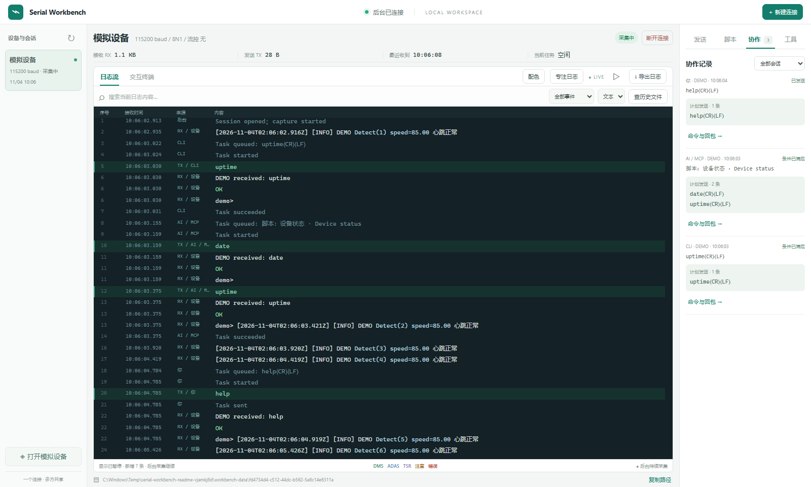
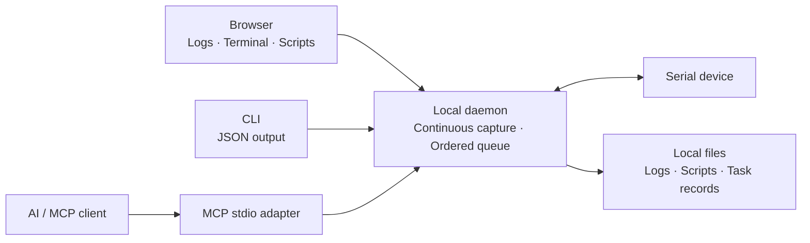
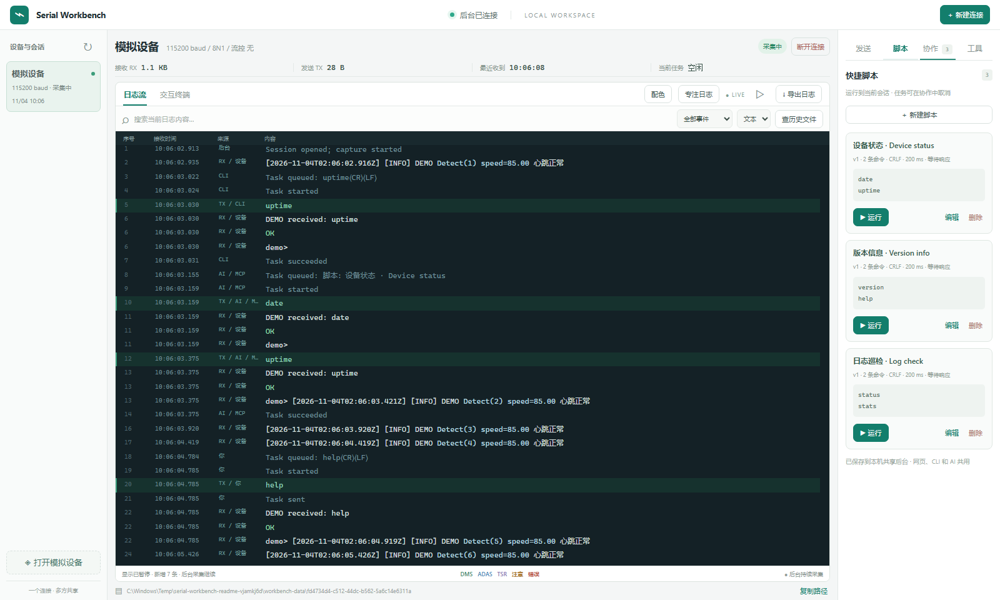
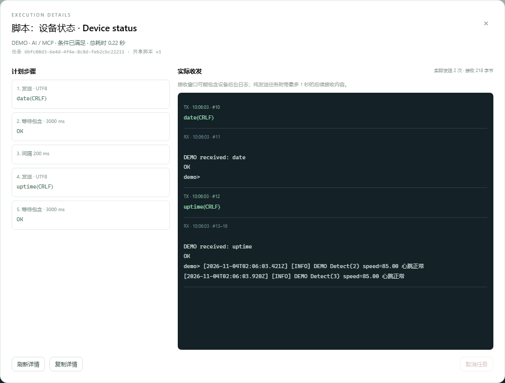

# Serial Workbench

**One serial connection. Shared by you and your AI tools.**

A local serial debugging workspace for embedded development, device bring-up and long-running log capture. One independent daemon owns the physical port; the browser, CLI and MCP adapter share its live stream, script library and ordered command queue. Keep watching the device while an AI agent reads logs or runs a reviewed script, then inspect exactly what it sent and received.

There is no need to repeatedly hand the port between a terminal and an agent. Capture continues when clients disconnect, and human takeover lets you intervene when you need to operate the device yourself.

**中文为主的完整首页见 [README.md](README.md)。** This page is the English companion.

Version **0.1.0** · [中文首页](README.md) · **English** · [Downloads](https://github.com/sinkinrin/serial-workbench/releases) · [Detailed guide (Chinese)](docs/WORKBENCH_ZH.md) · [Changelog](CHANGELOG.md)



> All screenshots come from an isolated built-in DEMO session, without real device logs, credentials or business data. `DEMO received` is a simulator echo, not a real device command result. The app does not automatically sanitize all logs.

## Use cases

| Scenario | Workflow |
| --- | --- |
| Embedded debugging | Watch live serial output while an agent inspects the same session and command responses. |
| Continuous observation | Keep capture running in the background and search disk history after reopening the browser. |
| Repeatable checks | Save common commands with line endings, delays and response conditions for use across clients. |
| Human–AI review | Inspect commands and replies, take control of sending, then release it to resume collaboration. |

## How it works



The daemon is the sole owner of the port. Browser clients use HTTP/WebSocket; CLI and MCP use the same backend. Each reader has its own event cursor. The service binds to local loopback for collaboration on one computer.

## Features

- **Continuous capture:** closing the browser or an MCP client leaves the daemon recording to rotating local files.
- **Compact browser workspace:** live logs, interactive terminal, text/HEX, search, pause, history and export. Custom keyword colors support priority and case matching.
- **Shared scripts:** save single commands or batches with line endings, delays and response waits. The browser, CLI and MCP share the library with revision checks.
- **Useful operation history:** command previews, source, port and status; expandable send/wait/delay steps and actual TX/RX. Records survive restarts.
- **Human control:** take over to block new AI/CLI writes and cancel queued work; release to resume sharing. All commands use one ordered queue.
- **Efficient AI access:** JSON CLI, 15 MCP tools and independent event cursors. Large historical searches can read local files directly.

## Screenshots

**Shared scripts:** review command previews, line endings, delays and response conditions in one library used by the browser, CLI and MCP.



**Command and response details:** inspect planned send/wait/delay steps alongside actual TX/RX, operation source and status.



See [screenshot notes](docs/assets/README.md) for data provenance and reproduction steps.

## Download and start

Download **Windows x64** package `serial-workbench-0.1.0-windows-x86_64.zip` from [v0.1.0](https://github.com/sinkinrin/serial-workbench/releases/tag/v0.1.0), extract it, and double-click `start-workbench.cmd`.

The launcher starts the daemon and opens `http://127.0.0.1:8765`. No Rust, Node.js or separate web server is needed. Your serial adapter still needs its Windows driver.

Or run from PowerShell:

```powershell
.\serial-workbench.exe serve
```

Open `http://127.0.0.1:8765`, choose **New connection**, and select the real port and device settings. Startup does not automatically open hardware. **Open simulated device** is a separate, labeled option for trying the UI.

Keep the daemon running while using clients. It listens locally by default. To change its port or data directory:

```powershell
.\serial-workbench.exe serve --port 8766 --data-dir C:\SerialLogs
.\serial-workbench.exe --url http://127.0.0.1:8766 status
```

## A shared debugging session

1. Start the daemon and open a real port in the browser, or explicitly open a simulated device.
2. Watch, search, highlight or pause the log view while background capture continues.
3. Let the agent list and reuse existing sessions, read events and run reviewed scripts by revision.
4. Open the collaboration panel to review the commands, execution steps and response window.
5. Take over when you need to operate manually; release control to resume shared sending.

## Shared CLI

These commands all use the daemon, without competing for its port. Output is JSON by default.

```powershell
serial-workbench ports
serial-workbench sessions
serial-workbench open --port COM6 --baud 115200
serial-workbench events <session-id> --after 0 --limit 100
serial-workbench send <session-id> --data uptime --newline crlf --wait --details
serial-workbench task <task-id> --details
serial-workbench scripts list
serial-workbench scripts show <script-id>
serial-workbench scripts run <script-id> <session-id> --revision 1 --wait --details
```

Adjust ports and commands for your device. Reuse an existing session when available. Pass the returned `next_cursor` as the next query's `after`; readers do not consume each other's data.

`--wait` waits for the host task. Without response checks, a send reports `sent` and a script reports `completed`. Matching all configured checks reports `succeeded`. These are not device process exit codes. Cancellation cannot undo sent bytes.

```powershell
serial-workbench takeover <session-id>
serial-workbench release <session-id>
serial-workbench cancel <task-id>
serial-workbench stop
```

`stop` closes the daemon and all sessions. Exiting a CLI or MCP client does not.

## MCP

Start the daemon first, then configure your MCP client to run the adapter:

```json
{
  "mcpServers": {
    "serial-workbench": {
      "command": "C:\\Tools\\SerialWorkbench\\serial-workbench.exe",
      "args": ["mcp"]
    }
  }
}
```

This is a generic example; the configuration location depends on the client. On Linux/macOS use your source-built executable path. MCP is optional: agents with local command access can use the CLI.

| Tools | Purpose |
| --- | --- |
| `serial_ports`, `serial_sessions`, `serial_open` | Discover ports and reuse/open sessions |
| `serial_events` | Non-consuming cursor reads |
| `serial_send`, `serial_macro` | Queue commands or JSON macros |
| `serial_task`, `serial_cancel` | Inspect commands/responses/status or cancel |
| `serial_scripts`, `serial_script_get`, `serial_script_save` | List, review and save shared scripts |
| `serial_script_run`, `serial_script_delete` | Run a reviewed revision or delete a script |
| `serial_control`, `serial_close` | Explicit control-line changes and session close |

`serial_task` returns details by default; use `details:false` for lightweight status polling. Review scripts before running and pass their revision. New AI writes are rejected while the human holds control.

## Data and upgrades

The launcher stores data in `workbench-data/` beside the application. Direct `serve` uses the current directory unless `--data-dir` is supplied.

| Path | Content |
| --- | --- |
| `scripts.json` | Shared script library |
| `tasks/<task-id>.json` | Commands, outcomes and bounded TX/RX details |
| `<session-id>/session.json` | Port settings, state and counters |
| `<session-id>/rx.log*` | Raw bytes; 10 MiB per file, up to 5 per session |
| `<session-id>/events.jsonl*` | Events; 20 MiB per file, up to 5 per session |

Task details retain up to 64 KiB / 512 events, ending one second after completion or at the next task. They may include unsolicited device logs. Gaps and truncation are marked; longer replies remain in session history. Interrupted tasks are never automatically replayed.

Browser-local scripts migrate to the shared library while keeping the old backup. Colors remain browser-local. Preserve `workbench-data` on upgrade and stop the daemon before replacing its executable. Old session directories and task files are not automatically removed.

Logs may contain credentials. Hidden input masks TX and task-detail transcripts, but raw RX can still contain device echoes. Review files before sharing.

## Build and verify

The manifest requires Rust 1.85 or later; version 0.1.0 was tested on Windows with Rust 1.94.1. Web assets are checked in and embedded. Node.js is only needed to change the UI.

```bash
git clone https://github.com/sinkinrin/serial-workbench.git
cd serial-workbench
cargo build --release --locked --bins
cargo run --locked -- serve
```

Frontend development requires Node.js 22+:

```bash
cd web
npm ci
npm run check
npm test
npm run build
cd ..
cargo fmt --all --check
cargo clippy --locked --all-targets --all-features -- -D warnings
cargo test --locked --all-targets --all-features
python -m pip install websockets
python scripts/smoke-workbench.py target/release/serial-workbench.exe
```

Linux/macOS use the path without `.exe`; Linux may require libudev development packages. Only Windows x64 binaries ship in this release. Automated smoke tests use isolated simulation. Real COM6/CH340 capture and read-only batches were also verified; USB hotplug recovery and electrical behavior were not.

## Practical notes

- Point browser, CLI and MCP clients at the same daemon. Other serial applications can still compete for the physical port.
- A successful response match is not a device process exit status. Cancellation cannot undo bytes already sent.
- Hidden input protects TX and task details; device echoes can still enter raw RX. Review logs, scripts and paths before exporting or taking screenshots.
- The simulator demonstrates UI and collaboration flows. Electrical behavior, device command semantics and hotplug recovery need hardware validation.

## Origin and compatibility

Derived from [Adancurusul/serial-mcp-server](https://github.com/Adancurusul/serial-mcp-server), retaining original history, MIT licensing and author attribution. Serial Workbench starts its own release series at **0.1.0**.

The `serial-mcp-server` direct-access binary and `serial_mcp_server` Rust library name remain compatible. Do not use direct mode on a port owned by the workbench. See [legacy CLI/MCP](docs/LEGACY_CLI.md); the existing `skills/serial-debug` also documents that legacy path. Macro JSON `schema_version` remains `0.3`, independently of the product version.

[MIT license](LICENSE) · [Changelog](CHANGELOG.md)
